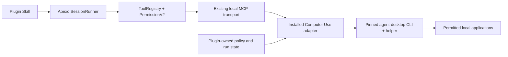

# Computer Use plugin development plan

Status: proposed; implementation and desktop acceptance have not started. Updated: 2026-11-16.

Build Computer Use as an optional installed plugin backed by `vercel-labs/agent-desktop`. Keep desktop behavior, native dependencies, application policy, reference ownership, and operational documentation in the plugin. Apexo continues to own prompts, model execution, permissions, tool history, cancellation, and plugin activation.

The delivery has two distinct milestones: a zero-host-change integration spike, then a supported plugin with one small, generic MCP extension for trusted caller identity. Passing the spike does not satisfy the release criteria. The detailed cases and evidence requirements are in [Computer Use plugin acceptance](computer-use-plugin-acceptance.md).

## 1. Scope and decisions

| Decision           | First supported release                                                                                                                               |
| ------------------ | ----------------------------------------------------------------------------------------------------------------------------------------------------- |
| Installation       | Existing trusted file/Git plugin bundle mechanism; explicit install and activation                                                                    |
| Execution          | Native V2 CLI and packaged Desktop, using a backend on the same machine and in the same user's graphical session                                      |
| Platform           | macOS first; claim arm64 or x64 support only after that artifact passes acceptance                                                                    |
| Desktop operations | List permitted applications/windows, inspect accessibility trees, act on refs, enter text, scroll, bounded key input, and capture the selected window |
| Model              | Existing Apexo tool-capable models; a vision-capable model is required for screenshot reasoning                                                       |
| Concurrency        | One active Computer Use run per OS user/desktop across plugin processes; unrelated Apexo work continues                                               |
| UI                 | Existing Plugins, MCP status, permission requests, tool results, and Stop control                                                                     |
| Host change        | Opt-in caller metadata for trusted local MCP tools; no Computer Use-specific host API                                                                 |
| Distribution       | Plugin-owned native adapter, upstream executable/helper, pinned versions, and license files                                                           |

Defer remote desktop bridging, WSL-to-Windows desktop control, browser/CDP integration, coordinate-only automation, held keys/buttons, clipboard access, notifications, arbitrary program launch, sandbox management, unattended background control, and a custom desktop preview panel. These can be separate plugin increments after the baseline is accepted. A local MCP process controls its own host's desktop; a remote Apexo backend does not acquire access to the frontend machine's desktop.

Do not add a second agent loop, an external model client, or a dependency on the Grok Build executable. Desktop runs are operational leases and ref namespaces, not Apexo Sessions, drains, transcripts, or durable prompt admission records.

## 2. Verified integration points and gaps

Source baseline: Apexo `d2ca7f0c6f65fd343bb5c7301cc79d85ae4626b1`; upstream `8ffecc1d3d088727f8d84baf4dde0224aab2e8ad`, whose package version is `1.3.1`. These identify the source review, not a tested release combination. Resolve and record the actual release artifact digest before implementation acceptance.

| Existing component                                                                         | Reuse and limitation                                                                                                                                                                                          |
| ------------------------------------------------------------------------------------------ | ------------------------------------------------------------------------------------------------------------------------------------------------------------------------------------------------------------- |
| [PluginBundle](../packages/core/src/plugin-bundle.ts)                                      | Loads `.mcp.json`, skills, commands, and agents. Expands package/data placeholders. MCP entries pass through V1 config and migration. Arbitrary new manifest fields do not automatically reach native config. |
| [PluginBundleRuntime](../packages/core/src/plugin-bundle-runtime.ts)                       | Stages activation and preserves the previous generation on preparation failure. Reload is rejected during active Location work.                                                                               |
| [MCP](../packages/core/src/mcp.ts)                                                         | Owns local transports, tool discovery, registration, and connection generations per Location. A connection can serve several Apexo Sessions.                                                                  |
| [McpTools](../packages/core/src/mcp-tools.ts)                                              | Has the authoritative Session, agent, message, and call context. Runs PermissionV2 before sending a call. Currently sends only tool name/arguments, and checks resource `*`.                                  |
| [McpCall](../packages/core/src/mcp-call.ts), [McpStdio](../packages/core/src/mcp-stdio.ts) | Provide request cancellation, bounded execution, transport retirement, and process-group cleanup. A cancelled request may retire the shared connection. Reconnect is not permission to replay an action.      |
| [ToolRegistry](../packages/core/src/tool/registry.ts)                                      | Preserves tool identity and bounds output. MCP image blocks already have a path into tool attachments; real provider consumption remains an acceptance requirement.                                           |
| [Persistent plugin data](plugins-persistent-data.md)                                       | Provides a writable epoch separate from the installed package, with existing retain/uninstall semantics.                                                                                                      |
| [V2 PluginContext](../packages/plugin/src/v2/promise/context.ts)                           | Has no public custom-tool registration hook. Use an installed MCP bundle; do not expand the in-process plugin API for this feature.                                                                           |

Upstream's MCP service fixes `--session`, `--agent-id`, and other global flags at process startup. Calling its session-start tool does not change later calls' session selection. It therefore cannot identify multiple Apexo callers sharing one Location connection. Its ref namespaces and interaction locks help, but neither supplies Apexo's caller identity nor reserves the whole observe/act/verify sequence.

Existing hooks carry some Session context, but hooks are separately scheduled and can be disabled. Do not infer the current MCP caller from a shared file containing the most recent hook's Session ID, or use model-supplied `session_id` arguments as authority.

## 3. Architecture and change boundary



The adapter is a local MCP server which translates a deliberately small typed tool surface into upstream CLI argument arrays. It checks caller/run ownership and application policy, then executes one bounded operation. The normal Apexo provider loop decides the next operation. The adapter must not call a model or autonomously continue a task.

| Area                                                | Planned change budget                                                                                                                     |
| --------------------------------------------------- | ----------------------------------------------------------------------------------------------------------------------------------------- |
| Plugin source and release                           | All desktop commands, process handling specific to upstream, refs, leases, policy, diagnostics, skills, binaries, and acceptance fixtures |
| Core MCP/config                                     | One opt-in context feature; approximately six existing production files, plus a helper only if needed for the identity boundary           |
| Existing tool/history/permission/lifecycle services | Reuse; no new desktop action types, tool registry, Session store, or execution coordinator                                                |
| App, TUI, Desktop                                   | No feature-specific UI required for v1; use current management and permission surfaces                                                    |
| Schema, Protocol, Server, Client                    | No new endpoints or database tables. Regenerate clients/SDKs if the additive config field changes an existing public schema.              |

File count is a review boundary, not a reason to omit a necessary contract. A proposal requiring a new host daemon, plugin framework rewrite, desktop state machine in Core, or custom permission UI must be split from v1 and justified separately. Keep Schema → Core/Protocol → Server dependency direction; the plugin must not import private Core/Server implementation.

## 4. Plugin package and distribution

Keep the plugin independently buildable, for example under a new `plugins/computer-use/` directory with its own build manifest and tests. That path is proposed and does not exist yet. It can later move to a separate repository without changing the runtime contract. Use a small Rust adapter for the first distributable: it can ship as a native executable without requiring globally installed Node or Bun in a GUI-launched Desktop process.

The assembled, platform-specific bundle is:

```text
computer-use/
  .claude-plugin/plugin.json
  .mcp.json
  README.md
  skills/computer-use/SKILL.md
  commands/computer-use.md
  bin/apexo-computer-use
  bin/agent-desktop
  bin/agent-desktop-macos-helper
  policy.default.json
  release.json
  licenses/
```

An optional agent can be added later; it must not select an unconfigured model or raise host permissions. The first command loads the Skill and reports setup status using normal tool calls. Installation and startup must not start provider work, capture the screen, operate an app, or prompt for OS permissions.

Proposed `.mcp.json` for the supported adapter:

```json
{
  "mcpServers": {
    "desktop": {
      "command": "${CLAUDE_PLUGIN_ROOT}/bin/apexo-computer-use",
      "args": ["mcp"],
      "env": {
        "APEXO_COMPUTER_USE_DATA": "${CLAUDE_PLUGIN_DATA}/computer-use"
      },
      "client_context": true
    }
  }
}
```

`client_context` is a proposed field, not supported configuration today. Old hosts must remain safe: the adapter can serve passive status/help without it, but must reject desktop access when trusted call metadata is absent. Declare the minimum tested Apexo version in `release.json` and README; do not assume the current manifest loader enforces a minimum-version field.

Release requirements:

- Pin the adapter, upstream executable, and helper together, with platform, architecture, hashes, and upstream source/tag provenance in `release.json`. Copy native files as regular executable files and preserve the helper's adjacency. Do not copy an npm installation tree or symlinks.
- Respect current PluginStore limits: at most 20,000,000 bytes per file, 200,000,000 bytes total, and 20,000 files. `node_modules` is omitted and symlinks are rejected. Check actual artifacts against these limits; do not enlarge host limits to accommodate a bundled JavaScript runtime.
- Verify upstream checksums and available provenance during assembly. Keep Apache-2.0 license/attribution and any applicable NOTICE material with redistributed upstream files. Record any changes to upstream source.
- Initially distribute an extracted platform bundle installable through `apexo plugins install --source /absolute/path/to/computer-use --trust`. A pinned Git/catalog source may follow using existing loader behavior. Direct ZIP installation and npm install hooks are not existing plugin capabilities.
- Perform downloads and assembly before activation. MCP startup must work offline and within the host's startup deadline. Never run `npx ...@latest`, a package installer, or a silent dependency upgrade during a tool call.
- Retain settings under the provided plugin data epoch; keep installed files immutable. Check a manually supplied external binary only through explicit local setup, with version/hash validation. The shipped default uses its adjacent binary, not an arbitrary PATH match.

For the spike only, replace the command with an explicitly provisioned absolute `agent-desktop` executable and pass `mcp` plus a fixed experiment session namespace. Omit `client_context`. Use an isolated test backend with a single test Session; this does not establish concurrent-session safety.

## 5. The small host extension: trusted MCP call context

Add a default-off `client_context` boolean to local MCP definitions. It is a generic opt-in for a trusted local executable. Reject it for remote transports in v1. Preserve it through these paths:

1. [Bundle mapping](../packages/core/src/plugin-bundle.ts).
2. [V1 MCP schema](../packages/core/src/v1/config/mcp.ts) and [V1-to-V2 migration](../packages/core/src/v1/config/migrate.ts).
3. [Native MCP schema](../packages/core/src/config/mcp.ts).
4. [MCP connection/tool construction](../packages/core/src/mcp.ts).
5. [McpTools call construction](../packages/core/src/mcp-tools.ts).

After the existing permission check and before dispatch, attach host-generated metadata alongside `arguments` in the MCP request. The proposed wire shape is:

```json
{
  "name": "computer_snapshot",
  "arguments": { "run_id": "opaque-plugin-run" },
  "_meta": {
    "io.apexo/call-context": {
      "version": 1,
      "owner": "opaque-owner-for-this-session-incarnation-and-connection",
      "sessionID": "host-session-id",
      "agentID": "host-agent-id",
      "messageID": "host-assistant-message-id",
      "callID": "host-tool-call-id"
    }
  }
}
```

The owner must distinguish a Session incarnation and an MCP connection generation, which is already Location-bound. Derive it from the captured [SessionLifecycle claim](../packages/core/src/session/lifecycle.ts), for example with a connection-scoped weak map and random opaque values. Do not rediscover ownership by bare Session ID after awaiting work, introduce a durable drain ID, or serialize the claim object. Missing/stale ownership fails before a context-dependent call executes.

The metadata is outside the model-visible input schema and is never merged from model arguments. Pass no credentials, prompt text, environment, or workspace files. Only explicitly opted-in local servers receive it; ordinary MCP requests remain unchanged. Status/help requests that do not access desktop content may work without metadata. The adapter trusts the parent stdio channel, not a bearer field the model can choose. This is isolation between calls through Apexo, not a sandbox against other programs running as the same OS user.

Propagate context through eager tools, deferred `use_tool`, and Code Mode's actual MCP execution path. The plugin should expose a small catalog, so it does not need Code Mode to function. Do not add Computer Use-specific branches to those paths.

A public config-schema change can require generated output updates even without a new endpoint. Run the canonical generators when required; never edit generated sources. Keep the normal PluginContext, PermissionV2 resource model, and SessionRunner orchestration unchanged for this milestone.

## 6. Adapter behavior

### Tool surface

Names below are plugin-facing proposal names. Apexo derives its model-facing MCP names; the Skill must use discovered tools rather than hardcode Apexo's hashed prefix.

| Tool/group                                                                 | Contract                                                                                                                                      |
| -------------------------------------------------------------------------- | --------------------------------------------------------------------------------------------------------------------------------------------- |
| `computer_status`                                                          | Report versions, supported capabilities, permission states, context support, and readiness without prompting or reading desktop content.      |
| `computer_help`                                                            | Return the installed version's usage/recovery guidance.                                                                                       |
| `computer_apps`, `computer_windows`                                        | List only policy-permitted targets; avoid titles/content from unrelated apps. Require caller context.                                         |
| `computer_start`                                                           | Select a permitted app/window, acquire the desktop lease, and return a fresh opaque `run_id`. It does not launch arbitrary executables.       |
| `computer_snapshot`                                                        | Return bounded accessibility data and refs for the selected target. Support compact/region reads; report truncation explicitly.               |
| `computer_click`, `computer_set_value`, `computer_type`, `computer_scroll` | Accept refs issued for this owner/run only. Validate the live target and capability before dispatch. One operation per call.                  |
| `computer_press`                                                           | Use an explicit key allowlist and selected target. Disable combinations that can escape the selected app or launch programs.                  |
| `computer_screenshot`                                                      | Capture only the selected permitted window and return an MCP image block plus dimensions. No arbitrary output path or whole-desktop fallback. |
| `computer_release`                                                         | End this owner's run and join its children before releasing control. Repeating release is harmless.                                           |

Do not offer raw CLI arguments, an eval/shell tool, upstream `batch`, arbitrary launch arguments, or upstream session/sandbox administration. Those would bypass the typed operation and policy boundary. Unsupported operations return a capability error; a Skill must not route around it through bash or another tool.

Use argument arrays without a shell. The adapter controls global flags, binary path, helper path, state root, and session namespace. Send typed text through upstream stdin where supported, so it is not exposed in the OS argument list. This does not remove text from Apexo's normal tool history; do not claim secret storage.

### Ownership, control, and interruption

- Bind `run_id` to the trusted owner and selected app/process/window identity. Model-visible `run_id` is a selector, not authority. Reject another caller's run/ref even when its exact string is known.
- Give every run a fresh upstream namespace, satisfying upstream's ID constraints. Same-Session reconnects, plugin reload, process restart, release, and lease expiry invalidate previous run IDs and refs. Start again and observe before acting; do not silently reuse old refs.
- Serialize commands within a run. Use a shared OS-user/desktop lease across Locations and plugin processes, held from `computer_start` to release/expiry. A second run gets `DESKTOP_BUSY`; do not queue hidden desktop actions. Upstream's shorter action lock remains additional protection.
- Keep that coordination lock outside versioned package/data epochs, at a private stable per-user location, so an update or a second Apexo data root cannot create an independent desktop lock. The lock contains only ownership/liveness information; it is not a background host service or a place for screenshots and application content.
- Default idle expiry is 120 seconds between plugin calls, configurable locally up to five minutes. Expiry requires a new run and snapshot. Time spent awaiting a human approval can expire a run; the subsequent call must fail safely instead of acting on old context.
- Hold the lease while a child is running. Cancellation, EOF, disconnect, or shutdown stops admission, terminates owned child work, joins it, invalidates the run, and then releases control. A process crash must not free control while a surviving descendant can still send input; use an inherited lock/guardian or an equivalent proven lifetime mechanism. Do not infer cleanup solely from the wrapper PID exiting.
- Use a 20-second maximum native operation deadline and a five-second cleanup budget for v1, within the current default 30-second host request budget. These are proposed bounds to verify, not measured performance. Keep model idle time separate from an executing operation.
- Never replay a mutation after timeout, cancellation, disconnect, or an uncertain delivery result. Preserve upstream error code and delivery/retry disposition. A new observation determines what happened before any new action.
- Track admitted message/call IDs within each live owner before spawning a child. An exact duplicate can return the recorded completed result or an in-progress/unknown error, but cannot spawn again. After a crash, old run IDs are invalid rather than recovered for execution. This bounded ledger does not schedule or resume work.
- Idle runs perform no background desktop actions. An interrupted model turn between calls may leave only an idle lease until expiry; document that bounded limitation. A new call from a retired Session cannot renew it. Active-call cancellation must stop native work within the tested cleanup bound.

The wrapper should call the CLI per operation, supplying its chosen namespace. Directly proxying one upstream MCP process cannot provide per-call namespace selection. A CLI child is implementation detail; all externally visible calls remain MCP tools in Apexo's standard execution path.

### Permissions and data

Keep Apexo's existing per-tool allow/ask/deny policy authoritative. Plugin trust, an app being on a list, and the OS Accessibility grant do not override a host denial. The current generic MCP permission request uses resource `*`; v1 must not advertise app-scoped saved approvals in Apexo's permission UI.

Enforce an additional plugin-owned application allowlist configured by the user outside model tools. Default to no application access until setup. Identify targets using stable platform identity and the actual running process/window, and revalidate after app restart. A ref must be tied to a previously permitted snapshot; accepting a ref string alone is insufficient. No tool can edit policy, enable headed mode, or expand capture scope.

Start with semantic accessibility actions. Headed input, when explicitly enabled in local policy, must still validate the exact target; reject any action whose target cannot be established. The human can change the UI at any time, so re-observation and stale-ref handling remain necessary even while the plugin holds its own lease. App targeting reduces accidental access; it is not an OS security sandbox or a complete classifier for sensitive actions inside an allowed app.

OS permission detection is passive. The setup instructions identify which packaged application/binary needs Accessibility and, for screenshots, Screen Recording. Let the user perform the grant; never edit OS privacy databases or assume a Terminal grant covers Electron's launch chain. Prefer an existing permission guide or setup command over a new host settings page.

Store refs and operational state in a private directory inside the provided data epoch. Default upstream trace and automatic screenshot persistence off. Return only task-relevant observations to the model. A requested screenshot necessarily enters the configured model's input and Apexo's normal history/attachment handling. Plugin diagnostics omit raw screen text, typed text, clipboard contents, and base64 images. Keep upstream error/disposition fields at the beginning of bounded error text so recovery survives the current MCP error truncation.

Persist settings across updates and normal disable/enable, but invalidate transient runs. Follow existing keep-data/uninstall and deferred cleanup behavior; never remove data still owned by a live process. A minimal operation receipt may record call identity, operation, target identity, timing, and delivery status. It is evidence for diagnosis, not a durable execution queue or authority to retry.

### Skill contract

The shipped Skill must describe the installed tool vocabulary, setup status, and supported app/operation scope. Load it through Apexo's existing Skill mechanism; MCP initialization instructions alone are not a guaranteed system-context source. Teach the sequence: check readiness, select a target, start a run, observe, perform one action, observe the result, and release when finished. Use compact/region reads to control context size and request screenshots only when they help the task.

Keep screen content as untrusted task data, explain stale-ref and delivery-uncertainty recovery, and require the agent to stop when the user takes over or the requested operation is unsupported. Do not copy upstream CLI examples that encourage shell execution around the adapter's policy. The Skill guides behavior; ownership, target validation, and permission enforcement remain executable checks.

## 7. Implementation sequence

| Stage                              | Work                                                                                                                                                    | Exit gate                                                                    |
| ---------------------------------- | ------------------------------------------------------------------------------------------------------------------------------------------------------- | ---------------------------------------------------------------------------- |
| P0: integration spike              | Isolated bundle with upstream MCP and Skill, pinned native executable, one test Session. Verify tool discovery, a real action, and an image round trip. | A01–A04; record limitations. Host source delta is zero.                      |
| P1: generic host context           | Implement the opt-in field and trusted metadata through bundle/migration/native execution. Add real MCP protocol tests.                                 | H01–H08. Ordinary MCP and disabled-plugin behavior remain unchanged.         |
| P2: plugin adapter                 | Build typed tools, app policy, run/ref ownership, cross-process control, deadlines, and cancellation. Package a native artifact.                        | P01–P14. No autonomous task loop.                                            |
| P3: installed integration          | Install the real bundle; test lifecycle, permissions, provider tool calls/results, and screenshot consumption through native CLI and rebuilt Desktop.   | I01–I10. Setup works with no global Node/Bun on the GUI PATH.                |
| P4: desktop acceptance and release | Execute fixture-owned UI scenarios plus real application tasks, review evidence, run required repository gates, and publish the versioned plugin.       | D01–D09 and release checklist pass on each advertised platform/architecture. |

Each implementation PR should identify the acceptance IDs it closes and the exact host/plugin/upstream versions. Keep the generic host change independently reviewable from the plugin. Do not merge a raw upstream MCP spike as the supported plugin. Adding Windows/Linux or remote placement requires a new platform acceptance record, not just a successful cross-compilation.

## 8. Design review checklist

- [ ] Every desktop-specific behavior lives in the plugin; host changes implement only generic caller context and any unavoidable generated schema outputs.
- [ ] The bundle is compatible with current installation, size, executable-mode, and data-epoch behavior.
- [ ] Caller identity is never taken from the model, hook timing, or a process-global last-session variable.
- [ ] App policy, native launch chain, output limits, cancellation, and lease recovery have observable failure cases.
- [ ] Tests exercise the installed plugin through Apexo; upstream tests and standalone CLI demonstrations remain separate evidence.
- [ ] The [acceptance record](computer-use-plugin-acceptance.md#evidence-and-release-checklist) shows proposed/not-run items honestly.

## 9. References

- [Native installed plugin lifecycle](native-plugin-runtime.md), [persistent plugin data](plugins-persistent-data.md).
- [Native MCP runtime](native-mcp-runtime.md); source is authoritative where historical feature documents lag current behavior.
- [Pinned upstream README](https://github.com/vercel-labs/agent-desktop/blob/8ffecc1d3d088727f8d84baf4dde0224aab2e8ad/README.md).
- [Pinned MCP implementation](https://github.com/vercel-labs/agent-desktop/blob/8ffecc1d3d088727f8d84baf4dde0224aab2e8ad/src/mcp/mod.rs) and [call/result mapping](https://github.com/vercel-labs/agent-desktop/blob/8ffecc1d3d088727f8d84baf4dde0224aab2e8ad/src/mcp/call.rs).
- [Pinned session semantics](https://github.com/vercel-labs/agent-desktop/blob/8ffecc1d3d088727f8d84baf4dde0224aab2e8ad/apps/docs/content/docs/sessions.mdx), [configuration](https://github.com/vercel-labs/agent-desktop/blob/8ffecc1d3d088727f8d84baf4dde0224aab2e8ad/apps/docs/content/docs/configuration.mdx), [macOS requirements](https://github.com/vercel-labs/agent-desktop/blob/8ffecc1d3d088727f8d84baf4dde0224aab2e8ad/apps/docs/content/docs/platforms/macos.mdx), and [installation](https://github.com/vercel-labs/agent-desktop/blob/8ffecc1d3d088727f8d84baf4dde0224aab2e8ad/docs/install.md).
- [Upstream Apache-2.0 license](https://github.com/vercel-labs/agent-desktop/blob/8ffecc1d3d088727f8d84baf4dde0224aab2e8ad/LICENSE).
