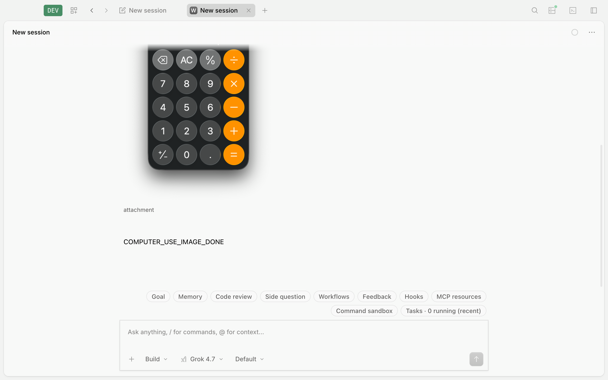
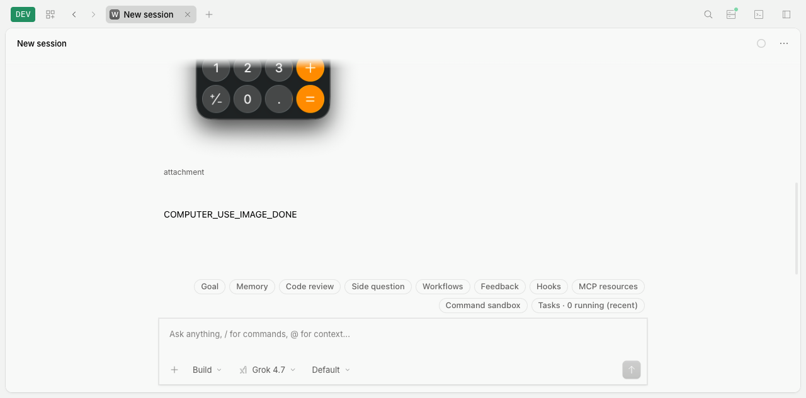

# Computer Use implementation and acceptance record

Date: 2026-11-16. Status: implemented and exercised on macOS arm64; the remaining manual/platform cases below are not certified.

## Delivered implementation

The standalone [Computer Use plugin](../../plugins/computer-use/README.md) contains the installed Skill, stdio launcher, pinned release assembler, V1/V2 permission profiles, license/attribution, and file checksums. It uses upstream MCP directly. No Computer Use-specific Core, Protocol, Server, Client, App, TUI, or Session API was added.

Two generic host corrections were required by real acceptance: Desktop now calls the current `service password` command, and Responses lowering omits the no-op `tool_choice: none` when no tools are present. Their [bug record](../testing/runtime/computer-use-host-integration.md) includes reproductions and verification.

The five launcher/assembly/Skill and host source files have a [source hash inventory](computer-use-source-identity.json), so that tested source remains identifiable independently of a later branch or PR title change.

## Artifact and environment

| Item                           | Recorded identity                                                                                                                                                                |
| ------------------------------ | -------------------------------------------------------------------------------------------------------------------------------------------------------------------------------- |
| Plugin                         | `computer-use` 0.1.0; MCP server `computer-use:desktop`                                                                                                                          |
| Host baseline                  | Apexo 1.18.35, baseline `d2ca7f0c6f65fd343bb5c7301cc79d85ae4626b1`, plus this implementation's two host corrections                                                              |
| Upstream                       | `agent-desktop` v1.3.1, unmodified native executable and matching helper                                                                                                         |
| Upstream arm64 archive SHA-256 | `9b7b7cfc74892eab46c2c85d6cb7dc4863bf8dab0a222cfcfb8ae4604c69c86c`                                                                                                               |
| Executable SHA-256             | `9a6b0829736a486da532a9d1ceed1e07192fa8967326c7b27125646adab6baf7`                                                                                                               |
| Helper SHA-256                 | `87348178e546974ee0f96b74dd03410f61f4972cae5eb5fbd36bf04d2cb50a42`                                                                                                               |
| Final plugin archive SHA-256   | `9c336d1ff3228c0cbf377dc7ba1ffd6d4cef28836f33edb63c121c41e53d2e08`                                                                                                               |
| OS                             | macOS 26.6.2, build 25G83, arm64                                                                                                                                                 |
| Native apps                    | TextEdit 1.20 (415), Calculator 12.0 (225), Preview 11.0 (1113.5.3)                                                                                                              |
| Runtimes                       | Bun 1.4.4, Electron 42.3.3; native compiled V2 CLI for the packaged Desktop                                                                                                      |
| Live model                     | `xai/grok-4.7`, low effort; existing Grok sign-in through Apexo's normal credential path                                                                                         |
| Controlled provider            | Isolated `computer-fixture/model`, local recording SSE server, no external model calls                                                                                           |
| Permissions                    | Exact selected tools allowed in controlled/live fixtures; separate `confirm` agent uses manual `ask`, default/global denial retained; recommended distributed profiles use `ask` |

The arm64 release archive was downloaded, checked against the pinned digest, and verified with `gh attestation verify ... --repo vercel-labs/agent-desktop --format json`. The verified statement includes the matching archive subject/digest. Both the builder's download path and offline assembly path were run. All twelve `SHA256SUMS` entries in the final extracted bundle verified. The generated native files stay in ignored build output.

The x64 archive was also downloaded and checksum-validated, and its `version` command ran under Rosetta on this arm64 machine. This is packaging evidence only; Intel graphical support is not accepted.

The tested native Desktop variant was rebuilt with `APEXO_SIDECAR_V2=1`, packaged as a real unsigned/ad-hoc-signed `.app`, and launched with that flag. It started its own isolated compiled CLI daemon. The tests did not attach the window to a substitute source backend. The default mixed sidecar advertises V1 to the frontend and is outside this native UI claim; see the plugin README for runtime/config selection.

## Executed tests

| Boundary                                    | Result and direct assertions                                                                                                                                                                                                                                  |
| ------------------------------------------- | ------------------------------------------------------------------------------------------------------------------------------------------------------------------------------------------------------------------------------------------------------------- |
| Plugin package                              | Four tests, 68 assertions: actual bundle-loader expansion, canonical tool IDs and permission decisions, corrupt archive rejection, adjacent executable/helper with hostile inherited helper path, minimal PATH and fresh namespaces                           |
| Config compatibility                        | One test, 80 assertions: V1 profile migration and V2 profile decode preserve selected-tool `ask` and unlisted-tool denial                                                                                                                                     |
| Responses regression                        | Two tests, four assertions: no-tool `none` is omitted; explicit `none` with definitions is preserved                                                                                                                                                          |
| Existing MCP/plugin/Client regression batch | 21 tests, 139 assertions, zero failures across MCP runtime, bundle runtime, reload guard, and Promise/Effect/SDK permission interoperability                                                                                                                  |
| Native CLI installed bundle                 | Nine checks, 12 controlled provider turns: actual Skill/tools/history, three Client families, manual ask accept/reject, forbidden launch has no marker-file effect, native cancellation and cleanup, update retention, reconnect, disable/uninstall/reinstall |
| Electron backend installed bundle           | Eight checks, ten controlled provider turns; same earlier lifecycle/Client/permission coverage and real descendant cancellation                                                                                                                               |
| Full native TUI mini                        | Three checks: actual terminal startup/Session attachment, a typed prompt invoking the installed tool, durable result and displayed completion                                                                                                                 |
| Full native TUI fullscreen                  | Same three checks through the full terminal interface                                                                                                                                                                                                         |
| Browser client E2E                          | Six checks: real Session UI, UI download/trust/install/apply, prompt/tool completion, inline screenshot decoding plus image in the next provider request, Stop, manual permission reject/accept                                                               |
| Packaged Desktop E2E                        | Seven checks: browser cases plus startup of its own native backend; actual `.app` window and compiled CLI used                                                                                                                                                |
| Packaged Desktop with live xAI              | Four checks: owned native backend, Session UI, installed plugin activation, real model Skill/version/permissions results rendered in the window                                                                                                               |
| Real CLI installer                          | `plugins install --source ... --trust` installed the actual assembled bundle as enabled in an isolated store                                                                                                                                                  |
| Direct MCP/ref boundary                     | Three checks: minimal PATH/private state/inline PNG; new namespace rejects old ref; closed target returns failure or uncertain delivery without changing fixture bytes                                                                                        |
| Live TextEdit                               | Real xAI edited English/Chinese/punctuation/newlines and saved; independent file bytes matched exactly. Separate live long-document scroll action completed.                                                                                                  |
| Live Calculator                             | Real xAI clicked native controls for `137 × 29`; a completed tool observation contained `3973`. A final-bundle rerun with randomized operands observed `137 × 52 = 7124`                                                                                      |
| Live vision                                 | Real xAI correctly identified a randomized left-to-right color order available only in screenshot pixels; image attachment and model answer independently checked                                                                                             |
| Manual OS permission follow-up              | Desktop denied/Accessibility-only/granted verified; CLI denied/granted passed, with attribution and intermediate-state limits.                                                                                                                                |

Fixtures may prepare disposable files, open test apps, select exact target windows, and independently inspect results. The UI operations completing the measured tasks flow through the installed plugin. Controlled-provider outcomes and live-model outcomes are separate evidence.

The [OS permission follow-up](computer-use-permission-transitions.md) records manual grant transitions, test identities, failed attempts, and cleanup without resetting existing user grants.

Measured native cancellation settlements included 15 ms on CLI and 26 ms on Electron backend; the final CLI run measured 47 ms. These are individual measurements, not a promised deadline. Tests waited for the actual native wait child to disappear, explicitly retried a retired connection, and did not replay the original action.

A real native child Task was also exercised with the installed plugin: the child agent's own independent Session could call `desktop_permissions`, while the same agent under a desktop-denied parent returned a tool error. This verifies inherited authority using the real Task/Session path.

The final launcher pins its helper path as well as its executable path. The full browser and packaged Desktop image scenarios used the final 0.1.0 bundle after that launcher correction. The final CLI/native-ref smoke also used that bundle. Earlier live-model application results used the same upstream/native tool behavior with the predecessor launcher, whose only behavioral difference was the now-fixed inherited helper override.

The final live xAI smoke also created a one-step agent with no permitted tools. Its text-only final turn completed with `TOOLLESS_XAI_DONE`, providing live-provider verification of the no-tools Responses regression fix.

The original new-document Save-dialog experiment reached the Save sheet and stopped during directory navigation. Computer Use 0.1.2 guides the model through the sidebar and a visible directory column. The controlled regression uses the release permission file and verifies a new RTF in a selected subfolder through independent readback. See [BUG-20261116-014](../testing/test-fixtures/computer-use-acceptance.md#bug-20261116-014-new-document-save-dialog-did-not-complete).

### Individual live-run measurements

These are transcript-derived measurements, not latency guarantees. Task time uses projected user-message creation through final assistant completion; provider turns exclude the preceding authentication/Skill smoke. Tool time uses the host's `ran`/`completed` timestamps, includes failed calls, and excludes Skill loading. The observation group includes passive desktop guidance/status calls. Image sizes are decoded inline PNG bytes.

| Scenario                         | Provider turns | Task seconds | Max observation seconds | Max action seconds | PNG bytes |
| -------------------------------- | -------------: | -----------: | ----------------------: | -----------------: | --------: |
| Existing-file TextEdit save      |             24 |       77.614 |                   0.938 |              0.258 |      none |
| Randomized Calculator            |             29 |       92.206 |                   2.410 |              0.160 |   288,279 |
| Long-document scroll             |              7 |       21.320 |                   0.403 |              0.102 |   489,353 |
| Pixel-only vision                |              8 |       27.170 |                   2.122 |          no action |   173,588 |
| New-document Save dialog, failed |             40 |      134.251 |                   1.759 |              8.079 |   495,323 |

All five measured runs settled within the fixture's 240-second wait. This does not make the failed Save task a pass or override upstream delivery/error information.

## Scenario matrix and unexecuted limits

This maps the [18 acceptance cases](../computer-use-plugin-acceptance.md) without treating partial coverage as a pass.

| Case | Result                    | Evidence or remaining condition                                                                                                                                                          |
| ---- | ------------------------- | ---------------------------------------------------------------------------------------------------------------------------------------------------------------------------------------- |
| B01  | pass, arm64               | Real archives, regular executable files/helper adjacency, checksums/licenses, store limits; x64 packaging only                                                                           |
| B02  | pass, native paths        | Offline/minimal-PATH launcher and actual packaged app execution, no global Node/Bun dependency in the plugin                                                                             |
| B03  | partial                   | Missing native/helper and corrupted archive covered; no true incompatible-architecture host was available (x64 executes under Rosetta)                                                   |
| B04  | pass, tested paths        | New namespaces, same private data epoch, tracing off, old refs rejected                                                                                                                  |
| I01  | pass                      | Absent/passive/install/activation and disable paths exercised without management-triggered model work                                                                                    |
| I02  | pass, tested authority    | Both profile dialects and other-agent rules; real manual approval; the real child succeeds independently but cannot lift its parent's desktop denial                                     |
| I03  | pass, tested rules        | Generic recording peer enforces permission-before-dispatch; installed plugin reject/accept and forbidden launch/no-effect checks passed                                                  |
| I04  | pass, default exposure    | Actual Skill, discovered names, provider results, history, native runner; deferred/Code Mode is not advertised by this profile                                                           |
| I05  | pass                      | Inline PNG is decoded in browser/Desktop, included as media in the next request, and consumed by live vision                                                                             |
| I06  | pass, tested cancellation | Actual native descendant stops; explicit recovery sends new work only; no original mutation is replayed                                                                                  |
| I07  | partial                   | Idle update, failed staging retention, busy reload via existing suite, disable and reconnect tested; no distinct older published Computer Use release exists for a version rollback test |
| I08  | pass, tested lifecycle    | Normal/keep-data uninstall/reinstall and existing live-reader data contract tests; connection authority is fresh after restart                                                           |
| D01  | partial                   | Separate Desktop: denied/Accessibility-only/granted verified. CLI denied/granted passed; its grant attribution and Accessibility-only stage remain uncertified.                          |
| D02  | pass on tested TextEdit path | Live Unicode edit/save and scrolling passed. The controlled 0.1.2 Save regression selected a nested folder, saved a new RTF, and matched exact decoded text under the release `ask` profile. |
| D03  | pass, tested app          | Calculator workflow independently observed with other fixture windows present                                                                                                            |
| D04  | partial                   | Exact-window/closed-target recovery and host-denied launch covered; a live screenshot/AX prompt-injection experiment is not certified                                                    |
| D05  | partial                   | UI Stop, real native wait cancellation and reconnection tested; crash during a delivered real edit is not certified                                                                      |
| D06  | pass, CLI live model      | Pixel-only marker, actual image attachment and correct xAI answer; no separate packaged-app randomized-marker run                                                                        |

Parallel desktop workflows, app confinement, secret entry, unattended runs, Windows/Linux, Intel graphical execution, and remote frontend control remain outside the supported scope. Existing positive grants do not prove denied-state handling. This record does not declare all 18 cases complete or universal desktop support.

## 2026-11-18 compatibility follow-up

The default packaged Desktop and the Web Client both installed and applied the original catalog bundle, exercised the MCP switch, and displayed the real `desktop_version` result in a Session created before installation. Run `bun script/computer-use-compat.mjs` from `packages/apexo` to exercise the same path through the mixed CLI. The tests used a loopback model fixture and a separate loopback OAuth MCP. [Compatibility bug and verification record](../testing/runtime/computer-use-host-integration.md#bug-20261118-003--the-compatibility-backend-leaves-plugin-data-unresolved)

The compatibility changes passed all 21 typecheck tasks and all six Turbo test tasks, including all 18 Apexo test batches. Client and legacy SDK generation checks produced no diffs. HTTP API coverage, auth, and effect modes each passed all 360 routes. App unit tests passed 114 cases.

## 2026-11-19 follow-up on PR 209

The audit used the published 0.1.1 bundle at revision `b9fdaf2b415b0a09221ff1af7e5203d233a44c67`, upstream agent-desktop 1.3.1, macOS arm64 26.6.2, Bun 1.4.4, and Electron 42.3.3. It used disposable profiles and loopback model fixtures. The one external model check received a reviewed synthetic Preview window capture.

| Surface | Observed evidence |
| --- | --- |
| Packaged Desktop | Default sidecar downloaded, trusted, installed, and applied the published pin. The MCP switch closed its process, retained the choice through Apply, and started exactly one process on Connect. A separate remote MCP still required OAuth. The native sidecar rendered real tool output and an inline PNG of a synthetic TextEdit window, settled the wait process on Stop, recovered, and presented manual reject and accept controls. |
| TUI and clients | Mini and fullscreen rendered actual tool execution and preserved native history. The compatibility TUI rendered an old transcript through each worktree spelling. Built Web exercised the native and compatibility paths. Promise, Effect, and legacy SDK clients accessed the installed server. |
| Upgrade and permissions | Profiles written by the earlier CLI and Desktop preserved both worktree spellings, Session history, Hook trust and denial, scheduler state, plugin state, and tool decisions. Read-only config startup succeeded. The old Desktop origin migrated to `apexo://renderer`, including the old Session opt-out. The settings switch changed the intended directory choice through both spellings. |
| Local process and graphical tests | Real Stdio refused missing native files and an incompatible file format. Busy Apply preserved the live generation. Abrupt loss removed the live wait child and recovery used fresh observations, with no wait replay. A stale ref did not change the closed synthetic document. The actual tools scrolled and saved Unicode text in an existing TextEdit file and verified a Calculator result. |
| Image delivery | Native Desktop and Web rendered inline captures and passed image input to the loopback provider. In a separate one-turn check, live Grok identified three randomized colors in a verified synthetic Preview screenshot. |

The catalog test installed 0.1.0, updated to the real 0.1.1 pin, and switched back to 0.1.0. All three stages used the same plugin ID and retained data. The x64 release also reported upstream version 1.3.1 under Rosetta.

Two runtime regressions were fixed during the audit. The compatibility backend now persists Disconnect across Apply and restart, and stdio cleanup now retires descendants after a spontaneous exit. [Host integration records](../testing/runtime/computer-use-host-integration.md)

The existing-file TextEdit trial using AX value assignment alone showed the new element value but did not persist it. Using clear and type through the actual plugin, followed by Save and an independent byte check, succeeded. The 0.1.2 follow-up verified new RTF creation through the TextEdit sidebar and column view. These runs used existing macOS grants. The denied-grant transition matrix, a true incompatible-architecture host, and graphical Intel execution were outside this follow-up.

## Failures and fixes retained

- [Bundle hashing](../testing/build/computer-use-bundle.md): fixed Bun byte-array compatibility and reverified assembly.
- [Host integration](../testing/runtime/computer-use-host-integration.md): fixed actual V2 CLI startup and xAI no-tool request failures.
- [Fixture failures](../testing/test-fixtures/computer-use-acceptance.md) records the catalog/Client shape, local-provider routing, TSX preload, runtime selection, UI readiness, rejected-drain sequencing, ref assumptions, and initial Calculator allowance failure. It also records the initial TextEdit menu timeouts and the 0.1.2 Save dialog follow-up.
- [Full repository gate](../testing/test-stability/computer-use-repository-gates.md): the first full test gate had three lifecycle timeouts. The unchanged focused rerun passed 87 tests with one skip. The final full-gate rerun passed all 18 batches; this passing rerun does not establish the original root cause.
- [Native permission transitions](../testing/permissions/computer-use-transitions.md): a first post-grant Desktop capture failed; a controlled relaunch succeeded, with root cause still unknown. Fixture lifecycle/state and CLI attribution limits are recorded separately.

## Repository verification

- `bun turbo typecheck --concurrency=2`: follow-up run passed 21 tasks, 20 cached.
- `bun run check:generated` in Client and legacy SDK: passed with no generated changes.
- `bun run test:httpapi`: coverage/auth/effect each passed 360 cases, no failures/skips/missing.
- Follow-up `GITHUB_ACTIONS=false bun turbo test --concurrency=2`: six successful tasks, three cached; all 18 Apexo batches exited zero in 12m15.937s.
- App unit tests: 114 passed, zero failures, 1,034 assertions. Desktop runtime-profile unit tests: three passed, eight assertions.
- CI results apply only to the exact pushed PR head; no merge is authorized by local results alone.

## Reproduce

From `plugins/computer-use`:

```sh
bun test test
bun script/build.mjs --arch arm64
```

From `packages/apexo`, with an assembled bundle at the default path or `COMPUTER_USE_BUNDLE` set to an absolute path:

```sh
bun test test/v2/computer-use-profile.test.ts test/session/llm-responses-tool-choice.test.ts
bun script/computer-use-native.mjs cli
bun script/computer-use-native.mjs desktop
bun script/computer-use-tui.mjs
bun script/computer-use-tui.mjs --fullscreen
bun script/computer-use-ui.mjs browser
bun script/computer-use-ui.mjs desktop
bun script/computer-use-ui.mjs desktop --live
bun script/computer-use-refs.mjs
bun script/computer-use-child.mjs
bun script/computer-use-live.mjs cli textedit
bun script/computer-use-live.mjs cli calculator
bun script/computer-use-live.mjs cli scroll
bun script/computer-use-live.mjs cli vision
bun script/computer-use-live.mjs cli smoke
bun script/computer-use-permissions.mjs
```

Run `bun script/computer-use-save.mjs cli` and `bun script/computer-use-save.mjs desktop` for the controlled new-document Save regression. Both read the assembled bundle's distributed permission profile. `bun script/computer-use-live.mjs cli save-dialog` exercises the same dialog with the configured live model.

The Desktop commands require the rebuilt V2-sidecar package; browser commands require the built App. Live commands use existing xAI credentials and incur provider usage. Desktop control scenarios must be run sequentially. Isolated child processes and created daemon PIDs are cleaned up by the harness; a pre-existing user app/server must not be stopped.

## UI evidence

The screenshots contain only synthetic fixture state. Raw transcripts/authentication data remain private.




