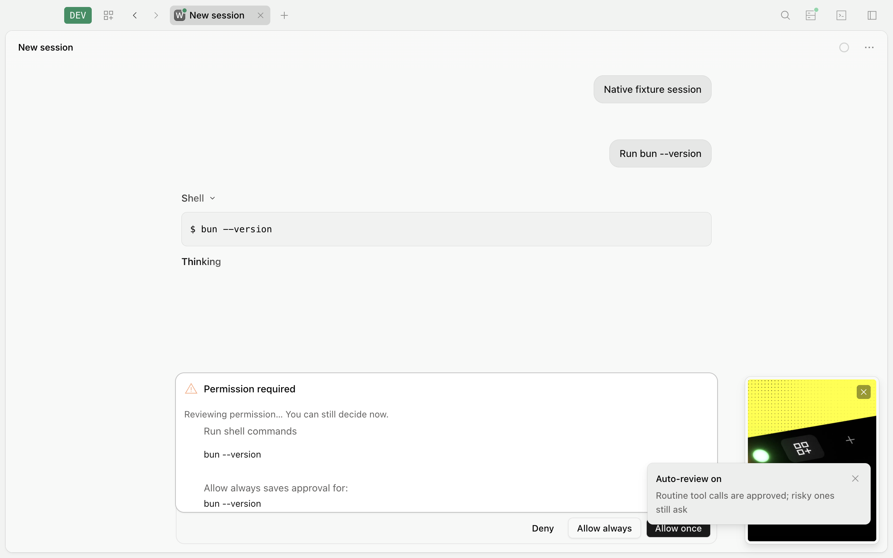
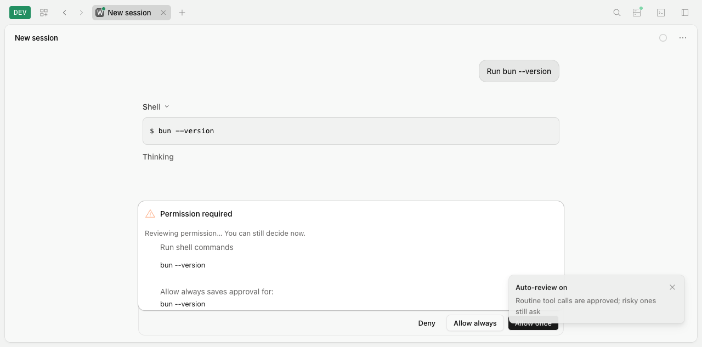

# F02 contextual permission review audit

Date: 2026-11-13, Asia/Singapore. Audited revision: `6f6f5b99a649f12cb7e959dc949fa17293839796` on `permission-review`; base `70a9f0d4`. Scope: section 6 and A01–A10 of [the agreed plan](codex-first-batch-plan.md), with actual terminal, Desktop and generated-client verification.

Current follow-up: the findings from both audits have been remediated on `permission-review`. The [complete scenario report](f02-reaudit-remediation.md) records passing runtime/client/UI regressions and preserves the separate pre-existing App unit-loader limitation. The original audit conclusions below remain historical evidence; PR #208 remains draft and unmerged.

**Conclusion: F02's main implementation is present, but it is not completely accepted. Three confirmed defects remain, including one P1. Fix them before merging.**

Status at `71d85e5b`: all three findings below are remediated. A [second audit](#second-audit-2026-11-14) found two residual F02 defects and two unrelated surface issues, so F02 remains not fully accepted.

The implementation [PR #208](https://github.com/cluster1900/apexo-code/pull/208) remains draft and unmerged. Its required `unit (linux)` and `typecheck` checks pass at the audited head. Those checks do not cover the additional failures below. This audit changes documentation and evidence only; no business code, commit, push or merge was made.

## Confirmed findings

| Priority | Finding | Evidence | Minimal correction |
| --- | --- | --- | --- |
| P1 | Scope capture can execute a repository Git wrapper before permission is granted. | A real native tool with cwd `repository/package` and executable `repository/bin/git` ran the wrapper 18 times while permission was still `ask_manual`; the reviewer returned `ask` and no manual reply was sent. `review-context.ts:144` checks only cwd containment, then `gitScope` executes that untrusted path. [BUG-20261113-F02-001](../testing/permissions/native-permission-review-audit.md#bug-20261113-f02-001-scope-capture-executes-an-unapproved-repository-git-wrapper). | Establish a trusted executable before running scope queries; unresolved or workspace wrappers stay manual without execution. |
| P2 | Fullscreen reconnect preserves the old review mode after backend reset. | Actual production providers fetched manual/revision 0 after previously showing review/revision 3, yet still rendered review. `context/permission.tsx:34` rejects the lower revision; reconnect at line 52 does not clear old state. [BUG-20261113-F02-002](../testing/ui/native-permission-review-audit.md#bug-20261113-f02-002-fullscreen-mode-cache-rejects-a-new-backend-incarnation). | Reset the incarnation-scoped cache at reconnect and apply authoritative mode, following the existing App pattern. |
| P2 | Default fullscreen mixed-host attachment does not enable native backend review. | A real PTY attached to an established native Session displayed `Auto-review on`, while GET still returned manual/revision 0. Server-wide legacy health selects compatibility in `transport/session.ts:16`, so the toggle remains frontend-local. [BUG-20261113-F02-003](../testing/ui/native-permission-review-audit.md#bug-20261113-f02-003-default-mixed-host-attachment-leaves-native-review-on-the-compatibility-path). | Select the native path for established native Sessions using existing identity evidence; retain compatibility for V1 and explicit compatibility selection. |

All three remain unfixed at this revision. No new subsystem, review history table, protocol endpoint or general shell interpreter is needed for these corrections.

## Cross-surface result

| Surface | Implemented and freshly verified | Remaining limitation |
| --- | --- | --- |
| Core and native HTTP | One backend owner, user-origin evidence, static policy precedence, one-shot tool-free review, bounded failures, invalidation, single settlement and inline pending state. Focused 41 tests / 244 assertions; pure/mixed HTTP 2 tests / 42 assertions. | The unapproved wrapper execution invalidates the read-only scope boundary. |
| Mini TUI | Native `/auto`, reviewing status, manual approval while streaming, fallback reason and disabling mode: 5 real PTY checks passed. Explicit native selection on a mixed host: another 5 passed. | The default mixed mini supplementary probe timed out and is inconclusive; it is not counted as accepted. |
| Fullscreen TUI | The same 5 ordinary native PTY checks passed; explicit native selection on a mixed host passed another 5. Stable permission root and active manual controls are implemented. | Default mixed-host selection and backend-incarnation rehydration fail as above. |
| Browser App | 8 production checks passed; mixed-host App passed 10. Two connected clients share one review, reload retains pending review, manual controls remain enabled and full-auto stays distinct. | No independent App defect confirmed by these cases; Core scope defect also affects it. |
| Desktop | A real Electron window using its own authenticated sidecar passed 8 checks, including backend toggle, reload, reviewing/manual controls, fallback and approval. Renderer shares the implemented App flow. | This audit reused the previously rebuilt Desktop artifact from this source revision; it did not perform a new build. Core scope defect also affects it. |
| Client Promise | Real HTTP GET/PUT, mode/start/settle SSE events, permission list/get inline status and reason, and manual reply all passed. | No generated Promise-client F02 defect found. |
| Client Effect | Real HTTP mode GET/PUT, mode/start/settle event streaming, pending list/get and manual reply all passed. Uses Schema/Protocol contracts without a Core/Server runtime dependency. | No Effect-client F02 defect found. |
| Legacy JS SDK | `client.v2.session.permissionReview.get/set` shares the same backend state; native UI paths also exercise the regenerated SDK. | No SDK F02 defect found. |

## A01–A10 assessment

| ID | Assessment | Evidence and boundary |
| --- | --- | --- |
| A01 | Implemented; tested ordinary precedence | Static allow/deny bypass reviewer. Existing inherited/saved/headless authority remains before native review and is rechecked before applying an approval. This audit did not add a separate exhaustive inherited-denial matrix. |
| A02 | Pass for tested scope cases | Matching publication to isolated local bare repositories, force and wrong-remote fallback, and changed HEAD rejection pass. Controlled model decisions establish orchestration rather than real-model judgment quality. |
| A03 | Partial | Non-user origins never become verified instructions; external metadata cannot fabricate runtime ownership. The custom executable can nevertheless run during capture before any permission decision. |
| A04 | Pass for tested cases | Unknown/imported/schedule/task/workflow inputs, queued/withdrawn inputs and copied history are excluded by the canonical input/effective-context selector. |
| A05 | Pass for tested races | Admission and mode changes invalidate held review streams; final settlement uses the admission fence and Session gate. |
| A06 | Pass for tested races | Manual once/reject, Session interrupt and sibling rejection revoke late results and complete cleanup without deadlock. |
| A07 | Pass for tested failures | Timeout, provider/503 failure, malformed response, unknown citation and oversized input fall back to manual. Reviewer transport retries are zero; normal retry behavior remains covered. |
| A08 | Partial | Browser, mixed App, own-sidecar Desktop, explicit native mini/fullscreen and two-client/reload flows pass. Fullscreen new-incarnation state and default mixed attachment fail. |
| A09 | Pass for tested event paths | Origin survives admission, exact retry, promotion, both projector paths and replay; absent old-event origin remains unknown and copy/fork does not gain trust. Existing Task/Workflow/Schedule ingress assertions remain in the implementation suite. |
| A10 | Partial | Literal shell/cwd facts, Git defaults/overrides, credential redaction, unsupported opaque commands and changed scope tests pass. Workspace-wrapper validation uses the wrong containment boundary and permits pre-approval execution. |

## Fresh checks and limits

Commands were run from `packages/apexo` unless noted otherwise. Tests launched and cleaned their own isolated fixtures; no existing user app or server was restarted.

- `bun test test/v2/permission-review.test.ts test/v2/permission-review-scope.test.ts test/v2/doctor-and-v2-hardening.test.ts test/event-manifest.test.ts`: **41 passed, 244 assertions**.
- `bun test test/e2e/v2-permission-review.e2e.test.ts`: **2 passed, 42 assertions**.
- `bun script/permission-review-tui.mjs` and `--fullscreen`: **5 checks each**.
- `bun script/permission-review-ui.mjs browser`, `mixed`, `builtin`: **8 / 10 / 8 checks** respectively.
- Supplemental real-client integration: **12 checks passed** across Client Promise, Client Effect and legacy SDK, including all three canonical review event types.
- Supplemental mixed-host PTY with explicit native transport: **5 checks each** for mini/fullscreen. Default mixed fullscreen fails the backend-mode assertion; default mixed mini timeout remains inconclusive.
- Supplemental direct-scope and native-runner wrapper assertions both fail. One production-provider reconnect render assertion fails. These supplementary failures establish the three findings and must not be hidden by ordinary-flow passes.
- The initial native-runner audit harness used an incorrect Location-service helper and was corrected before obtaining valid evidence; the first harness error is excluded from product findings.

The full unit, typecheck, generated-source and HTTP gates in [the implementation report](f02-implementation.md) were previously run at this code snapshot; they were not repeated wholesale for this documentation-only audit. Current PR required checks were directly queried and are green. No live-model judgment benchmark, Windows/Linux GUI run or signed-installer certification is claimed. The optional model evaluation script is not a missing mandatory deliverable.

[Normalized evidence](f02-audit-evidence.json) retains the observed states without credentials or temporary paths. Recommended next step: make the three bounded corrections and rerun their affected scope/terminal cases before merging.

## Remediation (2026-11-14)

The three findings above describe `6f6f5b99`; their original failure evidence is preserved. Follow-up changes on `permission-review` correct each at the existing boundary:

| Finding | Correction and fresh evidence |
| --- | --- |
| Pre-approval wrapper execution | Canonical executable checks cover enclosing repositories, not just the effective cwd. Git scope queries require the backend's installed Git identity before invocation. Explicit/PATH wrappers in repository siblings and outside the repository remain manual without running. A real native runner regression verifies no marker and no reviewer call. |
| Fullscreen reconnect mode | Clear old mode state on reconnect and reject previous-connection responses; preserve revision ordering within the current connection. Actual provider rendering verifies manual revision 0 and the next `/auto` toggle correctly enabling review. |
| Mixed-host terminal routing | Existing automatic transport selection consults the selected Session's canonical history. Fullscreen and mini startup provide the resolved ID; explicit compatibility still wins and history errors cannot silently change engines. Real mixed mini/fullscreen each pass 5 checks using the default protocol option. |

The combined focused command now passes **66 tests / 360 assertions**. Browser/mixed App checks pass **8 / 10**, and Client Promise/Effect/SDK integration passes **12**. Rebuilt Desktop and complete-gate results are recorded in [the implementation report](f02-implementation.md) after the final runs. No new API, persistence table, dependency or orchestration layer was introduced.

## Second audit (2026-11-14)

Scope: F02 section 6 and A01–A10 of [the plan](codex-first-batch-plan.md) at `71d85e5b` on `permission-review`, including fresh real CLI, mini/fullscreen terminal, browser App and Electron Desktop runs. The earlier findings and their remediation remain valid. This pass found **two new F02 defects and two unrelated surface defects**. All other checked behavior matches the agreed plan.

### New findings

`R2` findings belong to F02; `N2` findings are unrelated surface issues observed while exercising the same builds.

| ID | Priority | Finding | Minimal correction |
| --- | --- | --- | --- |
| R2-01 | P2 | Git scope capture only recognizes a command word that is literally `git`. A real Git reached through another executable name skips repository/remote/ref capture **and** the final scope revalidation. | Detect Git by the resolved executable identity as well as the command word, and normalize command words for wrapper checks. |
| R2-02 | P2 | A host-exported `GIT_EDITOR` disables native review for **every** Bash action, including commands and pushes that never invoke an editor. | Make environment sensitivity command-aware instead of rejecting every `GIT_*` except `GIT_PAGER` up front. |
| N2-01 | P3 (non-F02) | `apexo attach … --mini` prints an `AbortError` stack trace to the terminal on a normal double-Ctrl+C exit. | Treat an abort during stream teardown as normal. |
| N2-02 | P3 (non-F02) | On Desktop, the permission-mode toast stack is overlapped by the first-run "Introducing Tabs" card, truncating the toast text. | Hide/offset the help card while toasts are visible, or raise/offset the toast stack. |

Recommendation: correct R2-01 and R2-02 before merging F02. N2-01 and N2-02 are independent follow-ups and do not block F02 acceptance.

#### R2-01: Git scope capture keys on the literal name `git`

[review-context.ts](../../packages/core/src/permission/review-context.ts) recognizes Git in three places: the installed-Git identity check uses the lowercased `program` (`program === "git"`, line 149), while push capture uses a case-sensitive basename (`path.basename(words[0]!) === "git"`, line 174). The wrapper list is also case-sensitive (lines 128–129).

Direct capture probes against an isolated repository showed:

- `GIT push origin HEAD` (macOS resolves the uppercase name to the real Git binary) succeeds. The resulting facts contain `executable: "/usr/bin/git"`, `command: "GIT push origin HEAD"`, `args: ["push","origin","HEAD"]`, and **no `git` field**.
- `<temporary>/git2 push origin HEAD`, where `git2` is a symlink to the real Git binary, succeeds with the same shape.
- After committing a new HEAD, the alias fingerprint was **identical** to the pre-commit fingerprint. A held review therefore cannot reject a publication at a different HEAD, which is the A02/A10 revalidation guarantee.
- `git -C …`, `env git push`, dynamic substitutions and wrapper scripts named `git` continue to fail capture as intended. The regression tests for those cases still pass.

Impact: the reviewer can see a textual push and recent user intent while the backend supplies no repository, remote, refs, HEAD or credentials-redacted push URLs. An executable alias is a wrapper, and the audit's existing wrapper boundary requires manual approval. Windows command words such as `git.exe` would hit the same name check; that platform was not executed here.

Minimal correction: compute Git identity from the resolved executable (`executable === fs.resolve(which("git"))`) in addition to `program === "git"`, use the same identity for `gitScope`, and lowercase basenames when checking wrappers and exec vehicles. Unsupported argument shapes should still fail to manual approval.

#### R2-02: `GIT_EDITOR` disables all native review

The environment guard at [review-context.ts:118](../../packages/core/src/permission/review-context.ts#L118) rejects every captured environment key matching `GIT_*` except `GIT_PAGER`. `ShellEnvironment.subprocessEnv` inherits the host environment, so a developer or CI shell that exports `GIT_EDITOR=true` makes capture fail before any command analysis with `Custom shell or Git environment needs manual approval`.

Reproduction on this host:

- With `GIT_EDITOR=true`, `bun test test/v2/permission-review.test.ts -t "one tool-free backend review"` times out after 30 seconds because review never starts; the pending action silently stays manual.
- With `GIT_EDITOR=true`, `bun script/permission-review-tui.mjs` times out waiting for the review state instead of showing `Reviewing permission`.
- With `GIT_EDITOR=true`, two of the five `permission-review-scope.test.ts` cases fail with that reason.
- Unsetting `GIT_EDITOR` makes all three run green (focused 43 tests / 255 assertions, TUI 5 checks, scope 5 tests).

`GIT_EDITOR` does not affect `bun --version`, `bun test`, or `git push`; those actions never launch an editor. The existing note only justifies allowing the presentation-only `GIT_PAGER`. This is not a security hole, but it turns the feature off for a common developer environment without any UI indication beyond the manual fallback reason.

Minimal correction: evaluate environment sensitivity against the parsed command. Ignore `GIT_EDITOR`/`GIT_SEQUENCE_EDITOR` for commands that cannot invoke an editor, including push; keep rejecting `GIT_DIR`, `GIT_WORK_TREE`, `GIT_SSH_COMMAND`, `GIT_ASKPASS`, `BASH_ENV` and comparable execution-changing variables.

#### N2-01: mini attach writes an AbortError stack on normal exit

A real PTY attach (`apexo attach <url> --mini --no-replay --session <id>`) exits with code 0 after the second Ctrl+C, but the terminal then receives a full `DOMException: AbortError` dump whose stack points at [stream.native.ts:215](../../packages/apexo/src/cli/cmd/run/stream.native.ts#L215) (`signal.throwIfAborted()`), followed by the error object's enumerable constants. The same dump appeared after the acceptance script's SIGTERM cleanup in both pure and mixed mini runs. Fullscreen did not show it, consistent with its alternate-screen rendering; native-local `apexo --mini --session-protocol native` exits cleanly.

This is outside F02, but it corrupts the final scrollback/log of every native mini attach exit while the subscription is closing.

#### N2-02: Desktop toast stack overlaps the Tabs help card

In a freshly launched Electron window using its own backend, the three permission-mode toasts are drawn under/behind the first-run "Introducing Tabs" card at the bottom-right. The toast bodies are truncated, so the `/always-approve` feedback is unreadable until the card is dismissed. The card and the toast region occupy the same bottom-right area; the card is `z-50` in [help-button.tsx:29](../../packages/app/src/components/help-button.tsx#L29) and the toast region declares `z-index: 1000` in [toast-v2.css:2](../../packages/ui/src/v2/components/toast-v2.css#L2), so the observed stacking is not explained by those declarations alone.

This is outside F02. It was observed in both Desktop screenshots taken during the acceptance run.

### F02 conformance after remediation

| Item | Assessment | Evidence |
| --- | --- | --- |
| 6.1 Backend authority, mode pair, decision pair | Implemented | Modes are Session-incarnation live state; static allow/deny bypass the reviewer; no saved grants or reviewer transcript; external permission metadata cannot supply a runtime owner. |
| 6.2 Input origin and evidence | Implemented | `session_input.origin` is threaded through admission, promotion, both projector paths, old-event decoding and exact retries. Only the last five promoted, nonwithdrawn `user` inputs in effective history are eligible. Queued, withdrawn, imported, scheduled, workflow, task and internally synthesized inputs are excluded. |
| 6.3 Scope capture and bounded review | Partial | Literal Bash and literal `git push` cases are correct, including defaults, credentials redaction, force/delete, wrong remote and changed HEAD. R2-01 bypasses scope for aliased Git; R2-02 disables capture under `GIT_EDITOR`. |
| 6.4 Settlement and races | Implemented | One Session settlement gate plus the admission fence; manual reply, sibling rejection, cancellation and reviewed application settle once; fibers are joined outside the gate; a human result wins. |
| 6.5 API, events, clients | Implemented | GET/PUT mode with monotonic revision, start/settle/mode-changed events, inline `review` state on list/get, backend toggles in App and native TUI, full-auto remains separate. No audit table, history endpoint or client classification endpoint. |
| 6.6 Minimal footprint | Implemented | One column and one migration; no new dependency, orchestration engine or shell interpreter. The implementation stays within the planned boundaries; no over-design was required to reach the acceptance cases. |

| Acceptance | Result |
| --- | --- |
| A01 static precedence | Pass: configured/inherited denies never reach the reviewer (focused tests). |
| A02 authorized vs mismatched push | Partial: matching, force, wrong remote and changed HEAD pass for literal `git`; R2-01 skips the same checks for aliased Git. |
| A03 untrusted injection | Pass as tested: non-`user` origins and forged external metadata never authorize, and no recent-observation text is fed to the reviewer (more conservative than the proposal). |
| A04 historical/queued/withdrawn | Pass. |
| A05 admission/mode invalidation | Pass. |
| A06 interleaved settlement | Pass, including sibling rejection and late results. |
| A07 failure fallback | Pass: timeout, provider error, retryable 503, malformed JSON, unknown citation and oversized input fall back once with no reviewer retries. |
| A08 multi-client and surfaces | Pass for two clients, reload, pure/mixed mini+fullscreen, browser, and Desktop own backend. Cross-window `mode.changed` rendering was not separately asserted visually. |
| A09 origin event chain | Pass: admission, retry, promotion, both projector paths and replay. |
| A10 canonical scope | Partial: cwd/prefix, Git defaults overrides, opaque commands and changed scope pass for the literal name; aliases and `GIT_EDITOR` are R2-01/R2-02. |

### Fresh verification

All commands ran from `packages/apexo` unless stated otherwise. F02 commands and acceptance scripts ran with `GIT_EDITOR` unset; the explicit failure reproduction above is the only exception. Tests used isolated fixtures; no existing user server was restarted.

| Check | Result |
| --- | --- |
| `bun test test/v2/permission-review.test.ts test/v2/permission-review-scope.test.ts test/v2/doctor-and-v2-hardening.test.ts test/event-manifest.test.ts` | **43 passed / 255 assertions** (the implementation report records 41/244 for the earlier test set; the suite has since grown). |
| `bun test test/e2e/v2-permission-review.e2e.test.ts` | **2 passed / 42 assertions** on pure and mixed real HTTP hosts. |
| `bun test test/event-manifest.test.ts test/v2/doctor-and-v2-hardening.test.ts test/cli/tui/permission-review.test.tsx test/tui/native-session-transport.test.ts` | **30 passed / 164 assertions**, including fullscreen reconnect and mixed-host transport. |
| `bun test test/v2/task-message.test.ts test/v2/input-execution.test.ts test/v2/history-copy.test.ts test/v2/history-copy-runtime.test.ts` | **4 passed / 166 assertions** for origin and admission regressions. |
| `bun script/permission-review-tui.mjs`, `--fullscreen`, `--mixed`, `--mixed --fullscreen` | **5 checks each**: `/auto` enable/disable, one held review, manual decision during streaming, live fallback reason. |
| `bun script/permission-review-ui.mjs browser` | **8 checks**. |
| `bun script/permission-review-ui.mjs mixed` | **10 checks**, including legacy Session keeping its compatibility owner. |
| `bun script/permission-review-ui.mjs builtin` | **8 checks** in a real Electron window with its own backend. |
| Native-local CLI (`apexo --mini --session-protocol native`) | `/auto` enabled review, exactly one backend evaluation, reviewing badge, live fallback reason, manual approval and `/auto` disable all observed; clean exit. |
| `bun turbo typecheck --concurrency=2` | **21/21 packages** successful. |
| `bun run check:generated` in `packages/client` and `packages/sdk/js` | Both passed. |
| `bun run test:httpapi` | **360 scenarios in each of coverage, auth and effect modes**, 0 failures, skips or missing/extra scenarios. |
| Full unit gate | The first `bun turbo test --concurrency=2` run passed 5 of 6 Turbo tasks and 17 of 18 `apexo` batches; its only failures were the temporary failing audit probes that produced R2-01, which were then removed. The clean rerun of the `apexo` package passed **all 18 batches**, and every other Turbo task had already succeeded. The human-simulation round reran the complete gate: **all 18 `apexo` batches and all 6 Turbo tasks exited 0**. |

### Other observations (not classified)

- `apexo --mini` with the default `--session-protocol auto` exits on a V2-style config (`permissions` array) with `V2 permissions are not supported by the V1 config loader. Use V1 "permission" rules or run apexo2.` The explicit `--session-protocol native` form works and passed the CLI checks above. The repository has no `apexo2` command. Whether the compatibility entry point should auto-select the native path is a product decision; this audit does not count it as an F02 defect.

### Human-simulation re-test (2026-11-14)

Method: real `apexo attach` mini/fullscreen PTYs driven by typed input and key presses, a native-local `apexo --mini` run, an actual Chrome window through `agent-browser`, and a real Electron Desktop window with its own backend. Each session used the isolated permission-review fixture. Interactions were user-like: slash menu, approval/denial, Esc rejection and cancellation, reload, second tab, viewport resize, mode keys, command palette, toasts, and quit. This section records only the problems found.

#### R2-01 (re-confirmed): Aliased Git still bypasses scope capture and revalidation

Re-confirmed on the current head. The capture code keys on the command word `git` at [review-context.ts:174](../../packages/core/src/permission/review-context.ts#L174), while the identity check uses a different, lowercased form at line 149.

- `GIT push origin HEAD` and an absolute symlink `<tmp>/git2 -> /usr/bin/git` both capture successfully; the facts contain `executable: "/usr/bin/git"` but no `git` field.
- After a new commit, the alias fingerprint is identical. A held review therefore cannot notice that HEAD moved.
- Literal `git push`, `git -C`, `env git push` and repository wrappers still behave correctly, which is why the existing tests pass.

Expected: an executable that resolves to the installed Git must go through the same bounded scope capture and final revalidation, or remain manual.

#### R2-02 (re-confirmed): Inherited `GIT_EDITOR` still disables all native review

Re-confirmed end to end. With `GIT_EDITOR=true` in the host environment:

- `bun test test/v2/permission-review.test.ts -t "one tool-free backend review"` times out without starting a review.
- `bun script/permission-review-tui.mjs` times out waiting for the reviewing state.
- `permission-review-scope.test.ts` fails 2/5 with `Custom shell or Git environment needs manual approval`.

Unsetting `GIT_EDITOR` makes the same commands pass (combined focused + e2e suite: 45 tests / 297 assertions; TUI 5 checks; scope 5 tests). The guard is at [review-context.ts:118](../../packages/core/src/permission/review-context.ts#L118); `bun --version`, `bun test` and `git push` never invoke an editor.

#### U1. The `/auto` toast covers the primary permission button (non-F02 UI)

After `/auto`, the `Auto-review on` toast is rendered at the bottom-right, the same area as the permission footer. At the browser window height used by the acceptance route (1280×633):

- `document.elementFromPoint` at the center of `Allow once` returns the toast `<li>`, not the button. Measured at 1280×633: button 925.8–1019 × 575–603; toast 928–1248 × 508–596; the point (972, 589) hit the toast.
- A real mouse click at the button center leaves the permission pending; clicking the visible left edge settles it.
- The toast can therefore make the primary approval action look unresponsive for its lifetime.

Desktop shows the same bottom-right collision; there the Tabs help card also sits over the toast.

#### N2-02 (re-confirmed): Desktop Tabs help card covers other toasts

In a fresh Electron window the `Introducing Tabs` card (left 1068–1260, top 540–780 at this window size) overlaps the toast stack (left 928–1248, top 664–752). Toast text is truncated until the card is dismissed. The card is dismissible and the permission buttons remain clickable at this size, but the mode feedback is unreadable.

#### U3. Mini split-footer ignores the mode keys and has no always-approve command (non-F02)

In a real `apexo attach … --mini` PTY, the following keys produced no UI or backend change, while the same keys work in fullscreen:

- `Tab`: agent stays `BUILD` (fullscreen cycles Build → Plan).
- `Shift+Tab`: model/agent and backend review mode unchanged (fullscreen shows `Auto-review mode` and then `Always-approve mode`).
- `Ctrl+O`: always-approve stays off; the next permission still prompts (fullscreen toggles it).

The mini footer also reports `No matching items` for `/always-approve`, so there is no working way to enable full auto in that surface. The only mode control is `/auto` (native review). Expected: the split-footer should either honor the documented mode keys and the always-approve command, or the mini help should state that they are fullscreen-only.

#### U4. Escape does nothing on the App permission dock (non-F02 UI)

With a review pending in Chrome, pressing Escape leaves the permission request pending (`pending after Escape: 1`, status `reviewing`). The TUI permission dock explicitly documents `esc reject`, and the App question dock handles Escape to reject; the permission dock has no Escape handling. A user who learned the keyboard behavior in either other surface gets no response here.

#### N2-01 (re-confirmed): Native mini attach dumps an AbortError stack on a normal quit

Reproduced with the human PTY flow: two Ctrl+C presses exit with code 0, but the terminal receives a `DOMException: AbortError` object, including a stack pointing at [stream.native.ts:215](../../packages/apexo/src/cli/cmd/run/stream.native.ts#L215) (`signal.throwIfAborted`). The same dump appears in the acceptance script's SIGTERM cleanup for pure and mixed mini attaches. Fullscreen does not show it, and native-local `apexo --mini --session-protocol native` exits cleanly.

#### U6. Permission denial is presented as a normal completion or opaque failure (non-F02 CLI)

Two CLI surfaces hide the fact that the command was denied and never executed:

- **Mini footer:** after rejecting the pending bash request, the canonical transcript records `session.next.tool.failed` with `Tool execution interrupted` and `state.status: "error"`, but the terminal prints `bash completed · 60ms`. [tool.ts:693](../../packages/apexo/src/cli/cmd/run/tool.ts#L693) returns the completed label whenever the exit code is unavailable, regardless of error status. A user who denied the command is told it completed.
- **Headless run:** a native headless run that hits an ask under the reject policy exits 0 and records `bash: Unable to execute command: bun --version`; the JSON event has `metadata: {}` and the same text. Nothing says the command was not run because permission was denied.

Expected: a denied action should be reported as denied/not executed, not as a completed command or a generic execution failure. The App already renders `Failed · Tool execution interrupted` for the same case, which is the clearer behavior.

### Human-simulation coverage (summary only)

- Mini attach: composer, slash list, `/auto`, reviewing dock, allow, deny/reject, cancel reject, scroll, resize, command palette, quit-cancel, exit.
- Fullscreen attach: Tab agent cycle, Shift+Tab Normal → Auto-review → Always-approve, Ctrl+O, permission approve/reject, composer.
- Native-local CLI: `/auto`, reviewing dock, live fallback reason, manual approval, mode off, clean exit.
- Browser/Desktop: `/auto`, deny, approve, reload during review, second client, 1100×700 viewport, full-auto separation, command palette, help-card dismissal, console errors.
- No additional F02 defect was found beyond R2-01/R2-02; review start/settle state, inline reload state, two-client state, manual actions during streaming, full-auto separation and fallback reasons matched the implementation report.

### Limits

No real-provider judgment benchmark, Windows or Linux GUI run, signed installer, or backend-restart acceptance is claimed. The alias probe confirms the capture boundary and fingerprint behavior; whether a model would approve an aliased push still depends on its output. Cross-window `mode.changed` behavior is covered by unit transport tests but was not visually asserted in two live windows. The supplemental Client Promise/Effect/SDK integration harness referenced by the implementation report is not in the repository, so generated-source checks and the real HTTP/event suites were used instead.

## Second-audit remediation (2026-11-14)

The findings above describe `71d85e5b` and remain preserved. Follow-up changes fix R2-01/R2-02 and the accompanying N2/U client issues. [The remediation and scenario report](f02-reaudit-remediation.md) records exact fixes, permanent regression/e2e sources, actual CLI/mini/fullscreen/browser/Desktop interactions, before/after screenshots, composer samples and final gate results. The prior off-repository Client harness is now committed and runs against pure/mixed HTTP from a permanent e2e test. PR #208 remains draft and unmerged.
