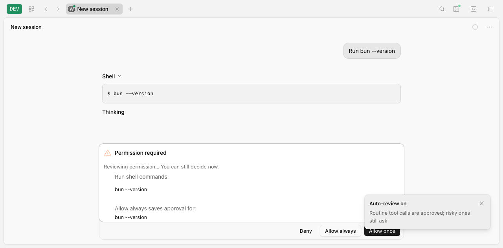

# F02: Native automatic permission review

Implementation branch: `permission-review`, based on `70a9f0d4` (`origin/main`).

## Delivered behavior

Native Sessions use backend-owned `manual | review` mode, defaulting to manual. `/auto` in mini/fullscreen TUI and App/Desktop changes that mode through GET/PUT `/api/session/:sessionID/permission-review`. Mode is live state of the current backend process and Session incarnation; a backend restart defaults to manual. Full auto remains an explicit separate frontend preference. Existing local review preferences do not enable native review. Runtime selection uses existing protocol/native markers and canonical admission history; ambiguous shared blank records keep the selected compatibility path until native use is established.

`PermissionV2` still evaluates configured, inherited, saved and headless authority first. Only an interactive pending permission with a private live tool owner can start native review. HTTP-created permission metadata cannot fabricate that owner. Unsupported action captures stay manual. V1 classifiers and LocalQwen hooks remain on their compatibility path.

Automatic action capture initially supports plain POSIX Bash invocations; unsupported shell modes remain manual. Bash captures its canonical cwd, effective shell, actual prefixed command, literal arguments, resolved executable and current sandbox/network policy. Git push capture resolves local repository, branch/HEAD/source commit/ref, selected remote, effective push URLs, branch destinations and force/delete flags through bounded read-only queries. URL credentials are redacted from resolved targets, review instructions and review reasons; fingerprints retain private comparison data. Dynamic/compound shell commands, wrappers, execution-changing environment overrides, custom push behavior, non-branch refs and unresolved destinations require manual approval. Confined commands also remain manual because host-environment Git queries cannot attest to a sandbox's fixed environment. Final capture is compared again before settlement.

The reviewer uses the Location's Session model through `SessionRunnerModel` and `LLMClient`. It makes one isolated streamed attempt with no tools, no transport retries, a 20-second timeout, at most two concurrent requests per Location, an 8,000-token upper bound using conservative UTF-8 byte budgeting and at most 512 output tokens. The exact action and latest verified instruction are never truncated. Malformed output, unknown cited instruction IDs, provider failure, timeout or excess budget leaves the request manual. The only model decisions are `allow_once | ask`.

The only database addition is `session_input.origin`: `user | task | workflow | schedule | imported | unknown`. Trusted ingress owns this value. Admission, promotion, historical synthesis and replay preserve it; absent old event fields decode to `unknown`, and exact retries retain existing attribution. Only the last five promoted, nonwithdrawn operator inputs still selected by effective Session history are authorization evidence. Queued inputs, imported history, scheduled work and generated content never become human instructions.

Manual replies, reviewed application, sibling rejection and cancellation share a Session settlement gate coordinated with the existing admission fence. Admission and mode changes synchronously invalidate snapshots; review fibers are joined outside settlement locks. Automatic decisions never create saved grants or reviewer messages in the Session transcript.

Clients receive canonical review start/settle notifications and inline pending status on list/get. Mode changes publish a small live notification so other connected windows update. There is no audit table, history API or client-triggered classification endpoint. Manual actions remain available during model streaming and after reconnect.

## Acceptance evidence

- `bun test test/v2/permission-review.test.ts test/v2/permission-review-scope.test.ts test/v2/doctor-and-v2-hardening.test.ts test/event-manifest.test.ts` passed **41 tests / 244 assertions**. Controlled native runner tests cover static policy, eligible instruction selection, all non-user origin classes, exact retry/replay, invalidation and settlement races, bounded failure behavior and forged external permission metadata.
- Actual Git publication tests use isolated local bare repositories: matching scope publishes once; force/wrong-remote cases remain manual; changing HEAD while review streams prevents publication.
- Scope tests cover Git defaults, exact refs, redaction, force/deletion flags, changed HEAD/remote and unsupported shell/config cases.
- Existing real Task/operator-message, Schedule and Workflow scenarios additionally passed **8 tests / 127 assertions**, with origin assertions on their canonical stored inputs or admission history.
- Real pure and mixed HTTP hosts passed **2 tests / 42 assertions**, including mode revision, server-owned origin, pending reload, shared backend ownership and manual settlement.
- Mini and fullscreen PTY acceptance passed **5 checks each**.
- Production browser acceptance passed **8 checks**; mixed-server browser passed **10 checks**, including preservation of the V1 review owner. Rebuilt Electron Desktop with its own backend passed **8 checks**. Each covered `/auto`, enabled manual actions, reload without duplicate review, live fallback reason, explicit approval and full-auto separation. Browser and mixed-server acceptance also used two simultaneously connected clients with one backend evaluation.

These controlled providers prove orchestration, authority boundaries and UI behavior. Real-provider judgment quality was not benchmarked.

The production browser shows the live backend review while keeping all manual actions enabled:

## Verification record

The repository typecheck gate passed all **21 packages** with `bun turbo typecheck --concurrency=2`.

`GITHUB_ACTIONS=false bun turbo test --concurrency=2` passed all **18 unit batches** (all **6 Turbo tasks** succeeded). The final credential-redaction edge correction and assertion also passed in the subsequent 41-test focused run; PR CI validates the committed snapshot. Both Client and legacy JavaScript SDK `check:generated` checks passed against staged canonical output.

`bun run test:httpapi` passed **360 scenarios each** in coverage, auth and effect modes, with **0 failures, skips or missing/extra scenarios** in all three modes.

## Production composer comparison

The same production command, `bun script/grok-plugins-ui.mjs cli --benchmark --benchmark-only` from `packages/apexo`, measured browser-clock time from reload request to the first visible composer animation frame using agent-browser. Each run collected ten samples in milliseconds.

| Run | Samples (ms) | Median | p95 |
| --- | --- | --- | --- |
| Before implementation | 214, 276, 735, 1129, 180, 191, 167, 175, 154, 169 | 177.5 ms | 1129 ms |
| After implementation, overlapping focused tests | 220, 246, 215, 190, 198, 215, 169, 189, 217, 1445 | 206.5 ms | 1445 ms |
| Final, after all tests finished | 179, 178, 177, 188, 174, 187, 181, 175, 162, 255 | 179 ms | 255 ms |

The final median was 1.5 ms (0.8%) above baseline. The earlier after-run overlapped focused regression tests, so its higher timings do not isolate application performance from host load. These small local samples and their individual outliers do not establish a statistically reliable speedup or regression. No performance improvement is claimed.

No PR is merged by this work.

Related development records: [native permission review](../testing/permissions/native-permission-review.md), [acceptance fixture corrections](../testing/test-fixtures/native-permission-review.md).
