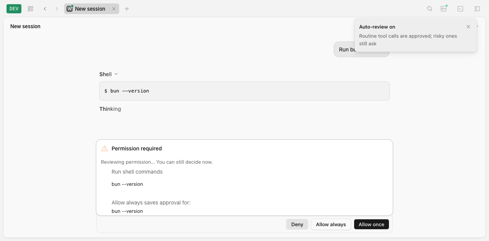
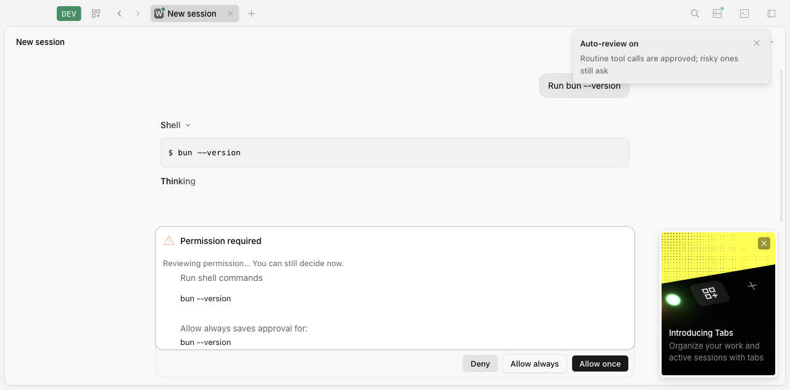

# F02 second-audit remediation and scenario verification

Date: 2026-11-14, Asia/Singapore. Branch: `permission-review`; starting revision: `71d85e5b`. [PR #208](https://github.com/cluster1900/apexo-code/pull/208) remains draft and must not be merged by this task.

The [user's second audit and human-simulation findings](f02-audit.md#second-audit-2026-11-14) are preserved as historical failure evidence. This change addresses both F02 defects and the accompanying client issues using the existing permission, stream, keymap and toast boundaries. No endpoint, database table, dependency or orchestration layer is added.

## Findings and fixes

| Audit finding | Resulting behavior | Regression / actual interaction |
| --- | --- | --- |
| R2-01: Git aliases omit scope | Canonical installed-Git identity selects scope capture and final revalidation for uppercase, symlink and `.exe` spellings. Normalized shell wrappers remain manual. | Four alias capture cases change fingerprint with HEAD/URL; held native aliased push cannot publish after HEAD changes. |
| R2-02: inherited editors disable review | Git editors no longer disable other executables, Git push or known read-only Git commands. Editor-capable/unknown Git commands and execution-changing hooks remain manual. | Positive/negative environment matrix includes Bun, `ls`, `cat`, seven Git subcommands and editor/alias negatives; **both variables set** in focused, e2e and real-client commands below. |
| N2-01: normal mini exit prints AbortError | Owned shutdown ends the turn normally and consumes the SDK reader-cancellation promise. The SDK change is reproduced by its generator. | Real HTTP blocked-reader cancellation plus complete raw PTY output after Ctrl+C and process exit. |
| N2-02 / U1: toast/help/dock collision | App feedback appears at the top inline end below the title bar in both toast implementations. | Visible toast required during `elementFromPoint` check; actual center mouse-down/up approves; Desktop Tabs card stays visible without toast overlap. |
| U3: mini mode keys / slash missing | Tab cycles primary agents; Shift+Tab uses the shared four-mode order; Ctrl+O and `/always-approve` select explicit full auto. Labels reflect actual state. | Production rendering, four real attach PTYs and native-local mini; full auto runs an ask-policy action with zero reviewer calls. |
| U4: App Escape ignored | Dock focuses its first action and Escape rejects, guarding responding/repeat/composition and stopping propagation. | Chrome and actual own-backend Electron keyboard interaction while review streams. |
| U6: denial appears completed/opaque | Failed Bash renders as failed, explicit decline states permission denial, and headless text/JSON explain that the command was not executed. | No marker file, no reviewer under headless rejection; actual mini, App/Desktop and three headless formats. |

Bug records: [scope/environment](../testing/permissions/native-permission-review-audit.md), [UI/controls/denial](../testing/ui/native-permission-review-audit.md), [SSE teardown](../testing/runtime/native-terminal-sse-teardown.md). Test preparation errors, the first failed Desktop catalog download, and unexplained startup deadlines remain separately recorded in [fixture stability notes](../testing/test-stability/native-terminal-backend-readiness.md#f02-second-audit-verification-setup-2026-11-14).

## Automated scenario matrix

Every test command below runs from `packages/apexo`. The permanent [client integration script](../../packages/apexo/script/permission-review-client.mjs) is now invoked by a committed e2e test on **pure and mixed real HTTP hosts**, replacing the prior supplemental harness outside the repository.

| Scenario group | Positive path | Negative / concurrent path | Test source |
| --- | --- | --- | --- |
| Canonical action identity | Literal and aliased Git, explicit/default push, force/delete facts, credential redaction | Changed HEAD/URL, repository/custom PATH wrapper without execution, compound/dynamic/wrapper/override commands, ambiguous refs | `test/v2/permission-review-scope.test.ts`, `permission-review.test.ts` |
| Environment | Bun version/test, `ls`, `cat`, push and read-only Git with both editors configured | Commit/rebase/merge/tag/unknown alias; Git path/SSH/askpass, shell startup and loader variables | `test/v2/permission-review-scope.test.ts` |
| Authority / provenance | One tool-free backend review, once-only action, no saved grant/reviewer transcript | Static allow/deny, forged external metadata, unknown/imported/task/workflow/schedule origins, queued/withdrawn/old inputs | `test/v2/permission-review.test.ts` |
| Invalidation / settlement | Exact action approved once | New admission, manual reply/reject, mode off, interrupt, sibling rejection and late reviewer result | `test/v2/permission-review.test.ts` |
| Bounded fallback | Live manual reason and usable controls | Timeout, malformed output, provider failure, retryable 503 without reviewer retries, unknown citation, oversized evidence | `test/v2/permission-review.test.ts` |
| Origin / replay / reconnect | Durable origin through admission/promotion/replay/retry; native mixed-host routing | Absent old origin, copy/fork trust, lower-revision new backend incarnation, explicit compatibility and failing identity probes | `test/v2/permission-review.test.ts`, `test/cli/tui/permission-review.test.tsx`, `test/tui/native-session-transport.test.ts` |
| HTTP / clients | Mode get/set, canonical mode/start/settle events, list/get inline status, manual reply | Duplicate mode set, two readers/reload, external metadata without owner, human result during held review | `test/e2e/v2-permission-review.e2e.test.ts`, `v2-permission-review-client.e2e.test.ts` |
| Terminal controls / errors | Shared keymap and slash mode actions; successful Bash still says completed | No prompt submission from mode commands; error without exit code says failed; headless rejection never creates a marker | `test/cli/run/footer.view.test.tsx`, `tool-inline.test.ts`, `test/v2/permission-review.test.ts` |
| Event-reader shutdown | Three fresh real HTTP subscriptions read the connected event | Abort each while its next read is blocked; no unhandled rejection | `test/sdk/native-sse.test.ts` |

The combined command passed **97 tests / 476 assertions, zero failures**:

```sh
GIT_EDITOR=true GIT_SEQUENCE_EDITOR=true bun test \
  test/sdk/native-sse.test.ts \
  test/cli/run/tool-inline.test.ts \
  test/cli/run/footer.view.test.tsx \
  test/v2/permission-review.test.ts \
  test/v2/permission-review-scope.test.ts \
  test/cli/tui/permission-review.test.tsx \
  test/tui/native-session-transport.test.ts \
  test/e2e/v2-permission-review.e2e.test.ts \
  test/e2e/v2-permission-review-client.e2e.test.ts
```

## Human-simulation / production e2e matrix

All commands below run from `packages/apexo` with `GIT_EDITOR=true GIT_SEQUENCE_EDITOR=true`. They use isolated owned fixtures and clean up their own processes; no existing user app/backend was restarted. Chrome is driven through `agent-browser`, terminals through actual PTYs, and Desktop through an actual Electron window with its freshly built authenticated Node sidecar.

| Command | Result | Actual operations and assertions |
| --- | --- | --- |
| `bun script/permission-review-tui.mjs` | **11 checks passed** | Type `/auto`; observe held reviewer and active approval; Enter approves; fallback reason; disable; Tab agents; Shift+Tab all modes; Ctrl+O runs without review; slash full-auto toggles; Esc plus confirm rejects; two Ctrl+C exit 0 without abort output. |
| Same, `--fullscreen` | **11 passed** | Same native behaviors in alternate-screen UI; root permission Esc rejects immediately; normal Ctrl+C exit. |
| Same, `--mixed` | **11 passed** | Default automatic transport on an established native Session in a mixed host; no forced native override. |
| Same, `--mixed --fullscreen` | **11 passed** | Same mode/control/settlement checks on default mixed fullscreen. |
| Mini, `--exit-active` and `--mixed --exit-active` | **12 each passed** | Additionally type a prompt through the actual composer, leave its tool blocked on permission, and double Ctrl+C. The active prompt transport and event reader close without an abort dump. |
| `bun script/permission-review-ui.mjs browser` | **14 passed** | `/auto`, visible-toast button hit test and actual center click during review, reload, second tab, streamed fallback, manual reply, cross-tab mode labels via command palette, Esc rejection, explicit full-auto execution and renderer-error check. |
| Same, `mixed` | **16 passed** | Same plus actual legacy Session retains its compatibility review owner. |
| Same, `builtin` | **13 passed** | Freshly rebuilt Desktop and its own sidecar; button-center click, visible Tabs card with no toast overlap, reload, Esc, fallback, full auto and no renderer errors. |
| `bun script/permission-review-cli.mjs` | **8 passed** | Native headless default/JSON/streaming-JSON all explain denial; local mini `/auto`, one review/human approval, fallback/rejection, Ctrl+O without review and clean double-Ctrl+C exit. |
| `bun script/permission-review-client.mjs`, then `--mixed` | **12 checks each**, also run by the e2e test above | Promise Client, Effect Client and legacy JS SDK share backend mode, all three review events, inline status/reason and manual reply over real HTTP. |

The browser and Desktop screenshots below retain the toast during a pending review at **1280×633**, the viewport that exposed U1. The Desktop shot keeps the first-run card visible. The tested Allow once center is unobstructed in both.





## Build, performance and repository gates

- Production App build passed. Fresh Desktop build passed for backend, main/preload and renderer. The build uses the supported local model-catalog snapshot input after the initial download failed; the UI fixtures use their controlled provider.
- Root `bun turbo typecheck --concurrency=2`: **21/21 packages passed**.
- `bun run check:generated` from both `packages/client` and `packages/sdk/js`: **passed**. SSE output is reproducible from the corrected SDK generator.
- Additional App `bun run test:unit`: **86 passed; 3 import failures / 3 errors**, caused by the previously recorded Solid `jsxDEV` loader problem. This command is not counted as green; production App/Desktop builds and actual UI acceptance above pass. See [the existing fixture record](../testing/test-fixtures/structured-review-fixtures.md).
- Complete unit gate, `GITHUB_ACTIONS=false GIT_EDITOR=true GIT_SEQUENCE_EDITOR=true bun turbo test --concurrency=2` from root: **18/18 Apexo batches and 6/6 Turbo tasks passed**, with no cached test tasks. No batch assertion, worker count or deadline was weakened. After extending the environment matrix, the final focused rerun passed **97/97 tests / 476 assertions**; PR CI checks the final committed snapshot.
- Complete HTTP gate, `bun run test:httpapi` from `packages/apexo`: **360/360 passed in each of coverage, auth and effect modes**, with zero failures, skips, missing or extra scenarios.
- Ten-sample production composer comparison, before → after: median **227.5 → 232.5 ms**, p95 **1085 → 1078 ms**, measured from browser reload request to the first visible composer frame. This small local sample shows no material regression and is not a performance improvement claim.

## Limits

Controlled providers establish orchestration, origin, races and user interactions; real Grok judgment quality was not benchmarked. No Windows/Linux GUI or signed-installer certification is claimed. Uppercase and `.exe` names are exercised as real symlinks on macOS, not as a Windows runtime claim. Apple's Git dispatcher can reject a renamed invocation even though canonical capture and changed-scope protection are correct. Default compatibility CLI auto-migration remains the product decision explicitly excluded by the audit.

[Normalized results](f02-reaudit-remediation-evidence.json) retain per-surface check names and composer samples without credentials or temporary paths.
